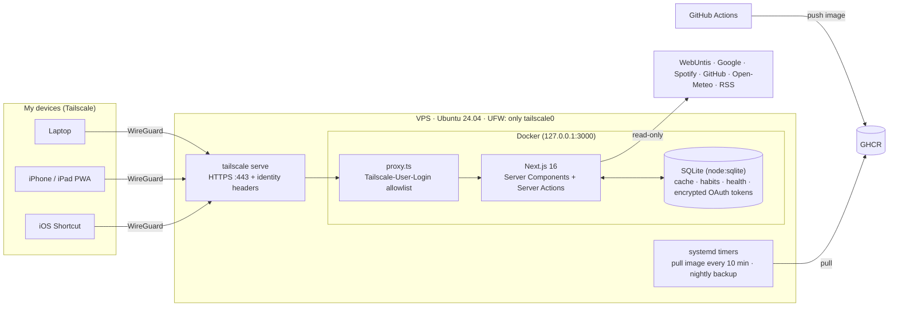

<div align="center">

# LifeOS

**A self-hosted life dashboard — school timetable, calendar, inbox, health, habits, code and music on one screen.**
Runs 24/7 on a 5 € VPS and is reachable **only inside my Tailscale network**.

[](https://github.com/ZitrusmitZ/lifeos/actions/workflows/ci.yml)
[](https://github.com/ZitrusmitZ/lifeos/actions/workflows/release.yml)


</div>

> Screenshots show the built-in **demo mode** (`DEMO_MODE=true`) with fictional data. The UI is in German because it's my personal tool.

## Features

| Widget | Source | Notes |
|---|---|---|
| 🎓 **School** | WebUntis | Today/next school day, double lessons merged, cancellations & substitutions highlighted |
| 📅 **Calendar** | Google Calendar | All visible calendars, next 7 days; create events from the "+" on Today (form or AI free text like "Mathe-Nachhilfe Do 16 Uhr"), optional push 10 min–1 day before |
| ⏰ **Reminders** | local SQLite + Web Push | One-off reminders with push at the chosen time (3 h catch-up, then "missed"); swipe to complete or delete |
| 🤖 **Mail assistant** | Gmail + OpenAI (`gpt-6-luna`) | Twice-daily triage of all connected inboxes: labels, archive, trash (recoverable). Hard safety rules + learned sender rules run before the model; uncertain mails wait for a one-tap decision; every action can be undone. Monthly cost cap. One-click "empty inbox" archives everything under a label |
| ✉️ **Inbox & Drive** | Gmail, Google Drive | Multiple Google accounts, unread per account, latest unread mails, recently edited files |
| 🗂️ **Drive cleanup** | Google Drive + OpenAI | On demand: exact duplicates, empty and never-edited untitled files go to the Drive trash (restorable for 30 days, one-tap undo); unclear files wait for a keep/trash decision; starred, shared, recently used and protected folders are never touched |
| 🌦 **Weather** | Open-Meteo | Uses the browser's location (rounded to ~1 km), hourly + 5-day forecast |
| ✅ **Habits** | local SQLite + Web Push | Daily, weekly (Mon–Sun), monthly or every N days; check off with optimistic UI, streaks in days/weeks/months, 16-week heatmap, emoji picker with suggestions, archive/restore/delete, per-habit reminders as push notifications (iPhone home-screen app, iOS 16.4+) |
| 🃏 **Flashcards** | local SQLite + FSRS (`ts-fsrs`) | Decks generated by AI from uploaded Markdown or written by hand; spaced repetition with interval preview, keyboard and swipe; Quick Learn to drill a deck without touching the schedule; "12 cards due" tile and briefing line |
| ⏱ **Focus timer** | local SQLite + Web Push | Pomodoro or stopwatch as a draggable pill on every page, picture-in-picture so it floats over other iPad apps, push when a phase ends; measured minutes per subject vs. the study plan |
| 🎯 **Grades** | local SQLite | Q1–Q4 grades per course (Brandenburg), adjustable exam share, "what do I need in the next exam for 12 points?", Block I/II and Abitur average projection, hint next to upcoming exams |
| 📊 **Weekly review** | local data + OpenAI | Sunday push and page: habits, study time (plan vs. actual), flashcards, sleep and new grades, with a short AI comment |
| ❤️ **Health** | iPhone Shortcut → Apple Health | Daily automation posts steps, sleep, workouts, energy, resting HR; manual entry; 14/30/90-day charts |
| 🧑‍💻 **GitHub** | GraphQL API | Contribution heatmap, recently pushed repos with CI status, open PRs |
| 🎵 **Music** | Spotify Web API | Now playing, recently played, top artists (PKCE, dev-mode-compatible endpoints only) |
| 📰 **News** | RSS / Atom | Tagesschau, politics, regional (rbb24), blue-light reports, heise, The Verge, Hacker News – thumbnails (feed media or the article's `og:image`), category tabs, local stories pinned |

Plus: two **MCP servers** for Claude inside the tailnet – a read-only Untis server at `/api/mcp` (timetable, changes, exams, homework) and a **LifeOS server** at `/api/mcp/lifeos` that reads *and* writes (check off habits, create reminders, add flashcards and grades, log health; deliberately no deletes, write tools are annotated so clients ask first) – plus per-widget streaming & error isolation and stale-while-error caching.

### Designed like an iPhone app

LifeOS lives on my iPhone home screen, so the UI follows Apple's Human Interface Guidelines instead of a web-dashboard template:

- **System font & Dynamic Type** – SF Pro on Apple devices; text scales with the iPhone's text-size setting while spacing stays put (`font: -apple-system-body`, spacing in px).
- **Apple system colors** with their *increased-contrast* variants for small text; every text token is checked against WCAG (≥ 4.5:1) in [`tests/contrast.test.ts`](tests/contrast.test.ts). Light/dark follows the system only.
- **Navigation:** floating glass tab bar (Heute · Schule · Habits · Lernen · Gesundheit) – like iOS 26, put your thumb on it and slide: the capsule follows, ticks on every tab and opens the one you let go on. Large titles collapse into a glass bar on scroll, settings behind a gear.
- **iPad:** same touch UI with the tab bar at the bottom, two columns in portrait and three in landscape; the classic top bar only appears with a mouse or trackpad.
- **Signature – day tiles:** one big number (next lesson, days until the exam, cancellations, temperature) with context underneath; the same shape counts down every exam.
- **Today first, customizable:** what matters today is shown large, everything else as compact tiles that expand in place; reorder and switch widgets between *large / tile / off* like home-screen widgets.
- **Touch:** swipe right to check off a habit or keep a mail, swipe left for archive/delete, taptic feedback on iOS 18+, 44 pt targets, Reduce Motion / Increase Contrast / Reduce Transparency respected.

<p>
  
  
  
</p>
<p>
  
  
</p>

## Architecture



**Key decisions**

- **Zero public attack surface.** The container binds to loopback; `tailscale serve` terminates TLS and injects the caller's Tailscale identity, which `src/proxy.ts` checks against an allowlist. After setup, even SSH is closed to the internet.
- **Pull-based deploys.** CI builds and pushes an image to GHCR; a systemd timer on the VPS pulls it. GitHub never needs credentials for the server.
- **One integration contract.** Every data source implements `Integration<T>` (`fetch`, `mock`, `missingConfig`, `ttlSeconds`). `load()` handles caching, demo mode, "not configured" and error states uniformly, so a broken API only affects its own card.
- **No native dependencies.** SQLite comes from Node's built-in `node:sqlite`, so the image needs no build toolchain; migrations run via `PRAGMA user_version`.
- **Secrets stay server-side.** OAuth refresh tokens are encrypted with AES-256-GCM; Spotify is read-only and Google gets only what a feature needs (calendar events, Gmail labels/trash, Drive trash – never permanent deletion); the health ingest endpoint uses its own bearer token with constant-time comparison.
- **AI with guardrails.** The mail assistant only sends sender, subject and Gmail's preview to the model, and its suggestions pass through deterministic rules (`src/lib/mail/policy.ts`): protected categories are never removed, deletion needs high confidence, nothing is ever permanently deleted. An end-to-end test runs the whole flow against mocked Gmail/OpenAI APIs and asserts exactly which calls happen.
- **Cache Components / PPR.** The static shell renders instantly; each widget streams in behind its own `<Suspense>` boundary.

More detail in [`docs/ARCHITECTURE.md`](docs/ARCHITECTURE.md).

## Tech stack

Next.js 16 (App Router, Cache Components, Server Actions) · React 19 · TypeScript · Tailwind CSS 4 · shadcn/ui · Recharts · Zod · `node:sqlite` · Vitest · Playwright · Docker · GitHub Actions · Tailscale

## Run it locally

```bash
git clone https://github.com/ZitrusmitZ/lifeos && cd lifeos
npm install
npm run dev:demo        # http://localhost:3000 with demo data, no keys needed
```

With real data: `cp .env.example .env`, fill in what you want (every integration is optional), then `npm run dev`.

```bash
npm test                # ~100 tests (parsers, cache, auth, ingest API, mail triage end-to-end)
npm run lint && npm run typecheck
docker compose up --build
```

## Deploy

One script turns a fresh Ubuntu 24.04 VPS into a Tailscale-only host running LifeOS (Docker, UFW, unattended upgrades, auto-update and backup timers):

```bash
gh auth login --web -s read:packages
sudo git clone https://github.com/ZitrusmitZ/lifeos /opt/lifeos
sudo bash /opt/lifeos/deploy/bootstrap-vps.sh
```

Step-by-step setup for Google, Spotify, GitHub, WebUntis and the iPhone Shortcut (German): [`docs/SETUP.md`](docs/SETUP.md).

## Project structure

```
src/
  app/              pages, API routes (OAuth, health ingest, healthcheck), server actions
  components/       widgets + UI primitives
  integrations/     one module per data source + load()/cache contract
  lib/              db, crypto, cache, habits, health, access rules, time helpers
  proxy.ts          Tailscale identity check
deploy/             bootstrap script, backup, systemd units
tests/              Vitest suites + fixtures
```

## License

MIT © ZitrusmitZ
