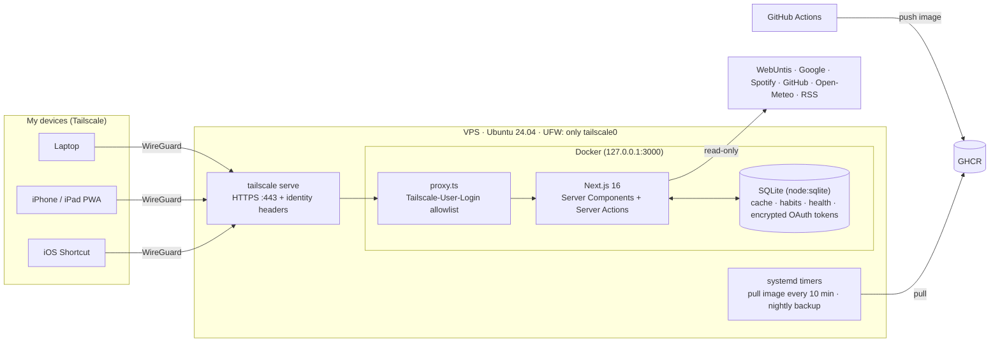

<div align="center">

# LifeOS

**A self-hosted life dashboard — school timetable, calendar, inbox, health, habits, code and music on one screen.**
Runs 24/7 on a 5 € VPS and is reachable **only inside my Tailscale network**.

[](https://github.com/ZitrusmitZ/lifeos/actions/workflows/ci.yml)
[](https://github.com/ZitrusmitZ/lifeos/actions/workflows/release.yml)


</div>

> Screenshots show the built-in **demo mode** (`DEMO_MODE=true`) with fictional data. The UI is in German because it's my personal tool.

## Features

| Widget | Source | Notes |
|---|---|---|
| 🎓 **School** | WebUntis | Today/next school day, double lessons merged, cancellations & substitutions highlighted |
| 📅 **Calendar** | Google Calendar | All visible calendars, next 7 days; create events from the "+" on Today (form or AI free text like "Mathe-Nachhilfe Do 16 Uhr"), optional push 10 min–1 day before |
| ⏰ **Reminders** | local SQLite + Web Push | One-off reminders with push at the chosen time (3 h catch-up, then "missed"); swipe to complete or delete |
| 🤖 **Mail assistant** | Gmail + OpenAI (`gpt-6-luna`) | Twice-daily triage of all connected inboxes: labels, archive, trash (recoverable). Hard safety rules + learned sender rules run before the model; uncertain mails wait for a one-tap decision; every action can be undone. Monthly cost cap. One-click "empty inbox" archives everything under a label |
| ✉️ **Inbox & Drive** | Gmail, Google Drive | Multiple Google accounts, unread per account, latest unread mails, recently edited files |
| 🗂️ **Drive cleanup** | Google Drive + OpenAI | On demand: exact duplicates, empty and never-edited untitled files go to the Drive trash (restorable for 30 days, one-tap undo); unclear files wait for a keep/trash decision; starred, shared, recently used and protected folders are never touched |
| 🌦 **Weather** | Open-Meteo | Uses the browser's location (rounded to ~1 km), hourly + 5-day forecast |
| ✅ **Habits** | local SQLite + Web Push | Daily, weekly (Mon–Sun), monthly or every N days; check off with optimistic UI, streaks in days/weeks/months, 16-week heatmap, emoji picker with suggestions, archive/restore/delete, per-habit reminders as push notifications (iPhone home-screen app, iOS 16.4+) |
| 🃏 **Flashcards** | local SQLite + FSRS (`ts-fsrs`) | Decks generated by AI from uploaded Markdown or written by hand; spaced repetition with interval preview, keyboard and swipe; Quick Learn to drill a deck without touching the schedule; "12 cards due" tile and briefing line |
| ⏱ **Focus timer** | local SQLite + Web Push | Pomodoro or stopwatch as a draggable pill on every page, picture-in-picture so it floats over other iPad apps, push when a phase ends; measured minutes per subject vs. the study plan |
| 🎯 **Grades** | local SQLite | Q1–Q4 grades per course (Brandenburg), adjustable exam share, "what do I need in the next exam for 12 points?", Block I/II and Abitur average projection, hint next to upcoming exams |
| 📊 **Weekly review** | local data + OpenAI | Sunday push and page: habits, study time (plan vs. actual), flashcards, sleep and new grades, with a short AI comment |
| ❤️ **Health** | iPhone Shortcut → Apple Health | Daily automation posts steps, sleep, workouts, energy, resting HR; manual entry; 14/30/90-day charts |
| 🧑‍💻 **GitHub** | GraphQL API | Contribution heatmap, recently pushed repos with CI status, open PRs |
| 🎵 **Music** | Spotify Web API | Now playing, recently played, top artists (PKCE, dev-mode-compatible endpoints only) |
| 📰 **News** | RSS / Atom | Tagesschau, politics, regional (rbb24), blue-light reports, heise, The Verge, Hacker News – thumbnails (feed media or the article's `og:image`), category tabs, local stories pinned |

Plus: two **MCP servers** for Claude inside the tailnet – a read-only Untis server at `/api/mcp` (timetable, changes, exams, homework) and a **LifeOS server** at `/api/mcp/lifeos` that reads *and* writes (check off habits, create reminders, add flashcards and grades, log health; deliberately no deletes, write tools are annotated so clients ask first) – plus per-widget streaming & error isolation and stale-while-error caching.

### Designed like an iPhone app

LifeOS lives on my iPhone home screen, so the UI follows Apple's Human Interface Guidelines instead of a web-dashboard template:

- **System font & Dynamic Type** – SF Pro on Apple devices; text scales with the iPhone's text-size setting while spacing stays put (`font: -apple-system-body`, spacing in px).
- **Apple system colors** with their *increased-contrast* variants for small text; every text token is checked against WCAG (≥ 4.5:1) in [`tests/contrast.test.ts`](tests/contrast.test.ts). Light/dark follows the system only.
- **Navigation:** floating glass tab bar (Heute · Schule · Habits · Lernen · Gesundheit) – like iOS 26, put your thumb on it and slide: the capsule follows, ticks on every tab and opens the one you let go on. Large titles collapse into a glass bar on scroll, settings behind a gear.
- **iPad:** same touch UI with the tab bar at the bottom, two columns in portrait and three in landscape; the classic top bar only appears with a mouse or trackpad.
- **Signature – day tiles:** one big number (next lesson, days until the exam, cancellations, temperature) with context underneath; the same shape counts down every exam.
- **Today first, customizable:** what matters today is shown large, everything else as compact tiles that expand in place; reorder and switch widgets between *large / tile / off* like home-screen widgets.
- **Touch:** swipe right to check off a habit or keep a mail, swipe left for archive/delete, taptic feedback on iOS 18+, 44 pt targets, Reduce Motion / Increase Contrast / Reduce Transparency respected.

<p>
  
  
  
</p>
<p>
  
  
</p>

## Architecture



**Key decisions**

- **Zero public attack surface.** The container binds to loopback; `tailscale serve` terminates TLS and injects the caller's Tailscale identity, which `src/proxy.ts` checks against an allowlist. After setup, even SSH is closed to the internet.
- **Pull-based deploys.** CI builds and pushes an image to GHCR; a systemd timer on the VPS pulls it. GitHub never needs credentials for the server.
- **One integration contract.** Every data source implements `Integration<T>` (`fetch`, `mock`, `missingConfig`, `ttlSeconds`). `load()` handles caching, demo mode, "not configured" and error states uniformly, so a broken API only affects its own card.
- **No native dependencies.** SQLite comes from Node's built-in `node:sqlite`, so the image needs no build toolchain; migrations run via `PRAGMA user_version`.
- **Secrets stay server-side.** OAuth refresh tokens are encrypted with AES-256-GCM; Spotify is read-only and Google gets only what a feature needs (calendar events, Gmail labels/trash, Drive trash – never permanent deletion); the health ingest endpoint uses its own bearer token with constant-time comparison.
- **AI with guardrails.** The mail assistant only sends sender, subject and Gmail's preview to the model, and its suggestions pass through deterministic rules (`src/lib/mail/policy.ts`): protected categories are never removed, deletion needs high confidence, nothing is ever permanently deleted. An end-to-end test runs the whole flow against mocked Gmail/OpenAI APIs and asserts exactly which calls happen.
- **Cache Components / PPR.** The static shell renders instantly; each widget streams in behind its own `<Suspense>` boundary.

More detail in [`docs/ARCHITECTURE.md`](docs/ARCHITECTURE.md).

## Telegram Agent

A Telegram bot that runs 24/7 next to LifeOS on the home server: it sends scheduled messages (morning briefing, server health, study reminders, your own jobs) and takes server tasks – but only from one Telegram user, and anything that changes the server needs a button tap first.

```
Telegram (long polling – no open port)
   │  only TELEGRAM_ALLOWED_USER_ID, 20 msgs/min
   ▼
Gateway ──► Router ──► local: Ollama (qwen2.5:3b)        trivial
   │          │        claude: `claude -p` (Pro plan)    simple → haiku · complex → sonnet · hard → opus
   │          │        api:    disabled (interface only)
   │          ▼
   │      Tools (fixed functions) ── confirm buttons (5 min) ── audit log
   ▼
Scheduler (agent.db, Europe/Berlin) ──► Telegram
```

- **Separate host process, same stack.** `src/agent/` is TypeScript run directly by Node ≥ 22.18 (type stripping, no build). It needs `systemctl`, `journalctl` and the `claude` CLI, so it runs as the unprivileged system user `lifeos`, not inside the hardened container. Own SQLite file (`/var/lib/lifeos-agent/agent.db`), same `node:sqlite` + `user_version` migration pattern.
- **Routing.** Rules first (slash commands, "Status", "Starte Minecraft neu", "Logs von ollama 50", "Erinner mich …") – no model involved. Otherwise the local model returns `{"complexity","needs_tools","category"}` as JSON (invalid → one retry → `complex`) and picks the tier. A failing/empty/slow (> 60 s) local answer escalates one tier. Every decision is logged (message hash, provider, model, reason, duration); `/model` shows the last one.
- **Claude only via the official CLI.** `claude -p --output-format stream-json --model <alias>` as a subprocess with `ANTHROPIC_API_KEY`/`ANTHROPIC_AUTH_TOKEN` stripped from its environment. Auth is the CLI's own (`claude setup-token` → `CLAUDE_CODE_OAUTH_TOKEN`); the agent never reads the token or `~/.claude/.credentials.json` and never calls the API with it. Usage-limit errors → Telegram notice with reset time, request goes into a persistent queue that runs after the reset, simple questions are answered locally meanwhile ("lokal beantwortet, Qualität eingeschränkt").
- **Server actions.** Typed tools only – no free shell, no `shell=True`, no string-built commands. Changes go through a root-owned helper (`deploy/agent/helper.sh`) that re-checks every verb and name against `/etc/lifeos-agent/helper.conf`; sudoers allows `lifeos` exactly that helper. Content from logs, Notion or the calendar is shown as data and never triggers a tool.

| Tool | Confirmation |
|---|---|
| `system_status`, `service_status`, `service_logs` (≤ 100 lines), `minecraft_status` | no |
| `service_restart`, `minecraft_say`, `minecraft_restart`, `backup_run`, `git_pull_project` | **yes** – exact command in the preview |
| `run_task` – delegates to `claude -p` with `Read/Glob/Grep/Edit/Write` (no shell) in `/var/lib/lifeos-agent/workspace` | **yes** – with Claude's plan as preview |

**Default jobs** (each switchable in `agent.env`): morning briefing weekdays 06:30 / weekends 09:00 (Notion "today" + overdue tasks by priority, today's calendar events via `GET /api/jobs/agent-briefing`, one server line only if something is off – missing integrations are skipped with a hint); health check every 15 min that only messages on problems (disk > 85 %, RAM > 90 % for > 10 min, service/Minecraft down, CPU > 80 °C; max once per hour per problem) plus a 21:00 summary; study reminder Mon–Thu 16:30. Jobs survive restarts; a missed run is caught up once if it is at most 1 h old.

### Setup

```bash
sudo bash scripts/install_agent.sh   # idempotent: Node, user `lifeos`, Ollama + model (MemoryMax=5G), helper, sudoers, systemd
```

1. **Bot token:** in Telegram talk to [@BotFather](https://t.me/BotFather) → `/newbot` → copy the token into `TELEGRAM_BOT_TOKEN` in `/etc/lifeos-agent/agent.env`.
2. **Your user ID:** message [@userinfobot](https://t.me/userinfobot) → put the number into `TELEGRAM_ALLOWED_USER_ID`. Everyone else is ignored (and logged).
3. **Claude:** `sudo -u lifeos -H /var/lib/lifeos-agent/.local/bin/claude setup-token` → put the token into `CLAUDE_CODE_OAUTH_TOKEN`. Without it the bot runs local-only and says so on start.
4. **Notion (optional):** create an internal integration at notion.so/profile/integrations, connect it to the task database (… → Connections), set `NOTION_TOKEN` and `NOTION_TASKS_DB_ID` (the 32-char ID in the database URL). Property names are configurable (`NOTION_PROP_*`).
5. **Calendar (optional):** `LIFEOS_CRON_TOKEN` is copied from `/opt/lifeos/.env` by the install script; needs a LifeOS image that includes `/api/jobs/agent-briefing`.
6. `sudo systemctl restart lifeos-agent` · logs: `journalctl -u lifeos-agent -f` (plus `/var/lib/lifeos-agent/logs/agent.log`) · health: `curl 127.0.0.1:8788/health`.

`node src/agent/main.ts --dry-run` (or `AGENT_DRY_RUN=true`) runs the full bot but only simulates changing tools.

**Commands:** `/status` · `/jobs` · `/job_add jeden Freitag um 16 Uhr an Wäsche` or `/job_add 0 16 * * 5 | Wäsche` · `/job_edit <id> <cron or "Mo–Do um 17:30"> | <text>` · `/job_del <id>` · `/model` · `/quota` · `/help`. Free text like "Erinner mich jeden Freitag um 16 Uhr an X" proposes `0 16 * * 5 – Freitags 16:00 – „X“` with buttons and is saved only after confirmation. Prefix the reminder text with `KI:` to have it generated through the router at run time.

**Config** lives in `/etc/lifeos-agent/agent.env` (template: [`deploy/agent/agent.env.example`](deploy/agent/agent.env.example)): model aliases (`CLAUDE_MODEL_SIMPLE/COMPLEX/HARD`, `OLLAMA_MODEL`), service/backup/project whitelists (must match `helper.conf`), health thresholds, job switches, `ENABLE_API_PROVIDER=false` (if enabled later: own API key, monthly budget and per-token prices required, cost logged per call).

**Extending:** a new tool is a `defineTool({...})` entry in `src/agent/tools/registry.ts` (Zod params, `kind: "read" | "change"`, `preview`, `run`) – plus a helper verb in `deploy/agent/helper.sh` if it needs root, and optionally a rule in `tools/intents.ts`. The agent cannot add tools at runtime. A new job type is a runner in `src/agent/main.ts` and an entry in `JobType`; default jobs live in `DEFAULT_JOBS` in `scheduler/scheduler.ts`.

## Tech stack

Next.js 16 (App Router, Cache Components, Server Actions) · React 19 · TypeScript · Tailwind CSS 4 · shadcn/ui · Recharts · Zod · `node:sqlite` · Vitest · Playwright · Docker · GitHub Actions · Tailscale

## Run it locally

```bash
git clone https://github.com/ZitrusmitZ/lifeos && cd lifeos
npm install
npm run dev:demo        # http://localhost:3000 with demo data, no keys needed
```

With real data: `cp .env.example .env`, fill in what you want (every integration is optional), then `npm run dev`.

```bash
npm test                # ~100 tests (parsers, cache, auth, ingest API, mail triage end-to-end)
npm run lint && npm run typecheck
docker compose up --build
```

## Deploy

One script turns a fresh Ubuntu 24.04 VPS into a Tailscale-only host running LifeOS (Docker, UFW, unattended upgrades, auto-update and backup timers):

```bash
gh auth login --web -s read:packages
sudo git clone https://github.com/ZitrusmitZ/lifeos /opt/lifeos
sudo bash /opt/lifeos/deploy/bootstrap-vps.sh
```

Step-by-step setup for Google, Spotify, GitHub, WebUntis and the iPhone Shortcut (German): [`docs/SETUP.md`](docs/SETUP.md).

## Project structure

```
src/
  app/              pages, API routes (OAuth, health ingest, healthcheck), server actions
  components/       widgets + UI primitives
  integrations/     one module per data source + load()/cache contract
  lib/              db, crypto, cache, habits, health, access rules, time helpers
  proxy.ts          Tailscale identity check
  agent/            Telegram agent (separate host process, see "Telegram Agent")
deploy/             bootstrap script, backup, systemd units; agent/ = agent unit, helper, sudoers
scripts/            install_agent.sh, screenshots
tests/              Vitest suites + fixtures
```

## License

MIT © ZitrusmitZ
