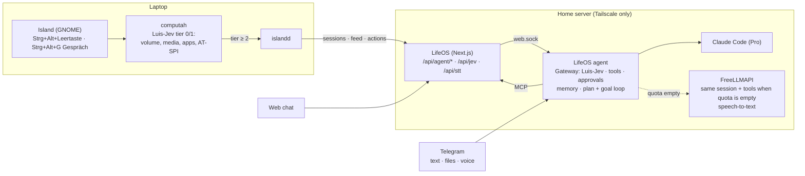

# Architecture

## Request flow

1. A device in the tailnet opens `https://lifeos.<tailnet>.ts.net`.
2. `tailscaled` on the VPS terminates TLS (`tailscale serve --https=443`), strips any client-supplied `Tailscale-*` headers and adds `Tailscale-User-Login` / `Tailscale-User-Name` for the authenticated tailnet user, then proxies to `127.0.0.1:3000`.
3. `src/proxy.ts` (Next.js 16's renamed middleware) runs `checkAccess()` from `src/lib/access.ts`: no identity → 401, identity not on `ALLOWED_TAILSCALE_USERS` → 403. Entries can be `owner` or numeric Tailscale user IDs, resolved to current logins via tailscaled's LocalAPI (socket mounted read-only, cached 60 s, re-fetched once on a 403) so a renamed login keeps working. `/api/ingest/*` (own bearer token) and `/api/health` (Docker healthcheck) are exempt.
4. The page renders a prerendered static shell (Cache Components / Partial Prerendering). Every widget is an async Server Component behind its own `<Suspense>`, so slow or failing sources never block the rest.

## Integrations

```ts
interface Integration<T, A = void> {
  id: string;
  ttlSeconds: number;
  missingConfig(): { hint: string; connectHref?: string } | null;
  cacheKey?(args: A): string;
  fetch(args: A): Promise<T>;   // real API
  mock(args: A): T;             // demo data, relative to "today"
}
```

`load(integration, args)` in `src/integrations/core.ts`:

- calls `connection()` so nothing is prerendered at build time,
- returns `mock()` in demo mode,
- returns `{ status: "unconfigured" }` with a setup hint if credentials are missing,
- otherwise reads through the SQLite cache (`src/lib/cache.ts`). If the upstream call fails and an older entry exists, it is served with `stale: true` and the card shows a small warning.

`src/integrations/loaders.ts` wraps each loader in React `cache()` so that e.g. the hero row and the calendar card share one Google request per render.

| Integration | TTL | Auth |
|---|---|---|
| Weather (Open-Meteo + Nominatim for the place name) | 15 min | none |
| News (RSS/Atom) | 20 min | none |
| GitHub (one GraphQL query) | 10 min | fine-grained PAT |
| Pi-hole v6 (summary, blocking, top blocked, own lists) | 1 min | app password → session ID, reused and renewed on 401 |
| Nextcloud (status, serverinfo, quota, WebDAV SEARCH for recent files) | 5 min | app password (Basic auth) |
| WebUntis | 15 min | username/password (`webuntis` package) |
| Google (Calendar, Gmail, Drive) | 5 min | OAuth 2 web flow, offline access; write access only for calendar events and Gmail/Drive trash |
| Spotify | 1 min | OAuth 2 + PKCE (no client secret) |

## Data

SQLite via Node's built-in `node:sqlite` (`src/lib/db.ts`), WAL mode, schema migrations tracked with `PRAGMA user_version`.

| Table | Purpose |
|---|---|
| `cache` | Integration responses with `fetched_at` / `expires_at` |
| `habits`, `habit_checks` | Habit definitions and one row per completed day |
| `health` | One value per `(day, metric)`; `source` = shortcut / manual / demo |
| `tokens` | OAuth tokens, AES-256-GCM encrypted (`src/lib/crypto.ts`) |
| `oauth_state` | One-time `state` values (+ PKCE verifier), expire after 10 min |
| `settings` | JSON settings per area (dashboard layout, mail assistant, reading goal …) |
| `push_subscriptions`, `habit_reminders_sent`, `reminders` | Web Push endpoints, sent habit pushes, one-off reminders |
| `mail_items`, `mail_rules`, `mail_runs`, `drive_items`, `drive_runs`, `llm_usage` | Mail assistant and Drive cleanup: decisions, learned rules, runs, AI cost |
| `briefings`, `weekly_reviews` | Generated daily briefings and Sunday reviews |
| `study_materials`, `study_plans`, `study_sessions`, `focus_sessions` | Study plan and measured focus time |
| `flashcard_sets`, `flashcard_decks`, `flashcards`, `flashcard_reviews` | Flashcards with FSRS state and review log |
| `grade_courses`, `grades`, `grade_overrides` | Grades per course and semester |
| `file_shares`, `file_uploads` | Nextcloud share links and chunked uploads |
| `books` | EPUBs: title, author, spine, TOC, cover path, position (chapter + fraction), percent, opened/finished; the file itself is `DATA_DIR/books/<id>.epub` (0600) |
| `reading_log` | Active reading seconds per `(day, book_id)` (heartbeat capped at 120 s per report) |
| `reading_pushes` | One row per day a reading reminder went out (prevents duplicates) |

The agent keeps its own database (`/var/lib/lifeos-agent/agent.db`): `jobs`, `pending_actions`, `audit_log`, `routing_log`, `claude_queue`, `api_usage`, `alert_state`, `health_events`, `coding_sessions`, `plans`, `profile`, `session_summaries`, `pending_uploads`, `permission_log`, `web_sessions`, `web_messages`, `kv`.

Writes go through Server Actions (`src/app/actions.ts`), each input validated with Zod. The health ingest route accepts the messy number formats iOS Shortcuts produce (`"7,5"`, `"8.432"`, lists).

## Routes

| Route | Purpose |
|---|---|
| `/api/health` | Docker healthcheck (no identity needed) |
| `/api/ingest/health` | iPhone Shortcut → Apple Health values (own bearer token) |
| `/api/auth/[provider]/start`, `…/callback` | OAuth for Google and Spotify |
| `/api/jobs/*` | Timer/agent jobs with `CRON_TOKEN`: mail triage, clear inbox, agent briefing, homeserver (Pi-hole/Nextcloud) |
| `/api/mcp`, `/api/mcp/lifeos` | MCP servers: Untis (read-only) and LifeOS (read + write, no deletes) |
| `/api/agent/*` | Web chat and Island: sessions, actions (buttons), feed, permission mode/log, uploads – proxied to the agent's Unix socket |
| `/api/jev`, `/api/stt`, `/api/spotify/playlists` | For the Island: TypeSafe Jev relay (OpenRouter), speech-to-text, playlist list |
| `/api/files/*` | Nextcloud browser: search, preview, raw, shares, chunked upload |
| `/api/books` (POST), `/api/books/[id]` (DELETE), `/api/books/[id]/progress` (POST), `/api/books/[id]/file/[...path]` (GET) | Reading: upload, delete, position + reading time, book files for the reader |
| `/lesen/weiter` | Redirect to the last unfinished book (or the library) – target of the reading push and the Island's "weiterlesen" |

## Reader security

EPUB chapters are foreign HTML. They are served by `/api/books/[id]/file/…` straight out of the ZIP (never extracted to disk) with
`Content-Security-Policy: default-src 'none'; img-src 'self' data:; style-src 'self' 'unsafe-inline'; font-src 'self' data:; media-src 'self'; frame-ancestors 'self'; sandbox allow-same-origin`,
`X-Frame-Options: SAMEORIGIN` and `nosniff`, and shown in an `<iframe sandbox="allow-same-origin">`. So a book can't run scripts, load anything
from outside or be framed elsewhere. `allow-same-origin` lets the reader page set font and colors, measure the scroll position and intercept links
(internal → next chapter + anchor, external → new tab). The parser (`src/lib/epub.ts`) rejects paths that leave the archive root and caps
entry count and uncompressed size (zip-bomb guard); uploads are limited to 50 MB.

## LifeOS, agent and Island



## Deployment

- `Dockerfile`: multi-stage build, Next.js `standalone` output, runs as `node`, healthcheck on `/api/health`.
- `compose.yaml`: port published on `127.0.0.1` only, 512 MB memory limit, `no-new-privileges`, all capabilities dropped.
- `.github/workflows/release.yml`: builds and pushes `ghcr.io/zitrusmitz/lifeos:{latest,sha}` on every push to `main`.
- `deploy/systemd/lifeos-update.timer`: `git pull`, `docker compose pull && up -d` every 10 minutes (pull-based CD, no inbound access needed).
- `deploy/systemd/lifeos-backup.timer`: nightly `VACUUM INTO` snapshot, 14-day retention.
- `deploy/bootstrap-vps.sh`: idempotent provisioning; `--lockdown-ssh` closes public SSH once you're connected through Tailscale.
